# Halo_Serdes GUI 图文导览 / Visual Tour

逐个视图的截图导览。GUI 用法与安装见 [`GUI.md`](GUI.md);下面每张图都是本地启动
`halo-serdes-gui` 后实跑截取(2026-10-29,界面改版阶段 2 之后全部重拍)。三个演示配置:

- **场景 A** — `NRZ 16G mixed-signal` 预设(CTLE + 4-tap DFE + bang-bang CDR,touchstone 背板),
  码型改成 prbs7,好让抖动分解有重复周期可折叠。
- **场景 B** — `PAM4 224G ADC` 预设(106.25 GBd,TI-ADC + 数字 FFE/DFE + MM-CDR,解析信道)。
- **场景 C** — `PAM4 100G/λ LPO (VCSEL + OM4)` 预设(光拓扑)。

```bash
pip install -e ".[gui,jit,fec]"
halo-serdes-gui        # → http://127.0.0.1:8050/
```

> 2026-10-29 更正:此前的截图是 17 个平铺标签页的旧界面(其中原图 4 实际截的是 CDR 页)。
> 改版后页面按链路组织:顶栏、左侧链路分段、右侧四个工作区,标签页对应关系见各节标题。

---

## 0. 布局

- **顶栏**:预设(选中即加载)、接收机架构开关(`rx.arch`)、推导值、▶ Run(运行时显示阶段、耗时、
  进度条和 ■ Cancel)。
- **左侧:链路**。每段一张卡片,写着当前设置;点一段,下面出现这一段的常用参数,其余在
  "Advanced (n)" 里。只显示当前配置用得到的字段(例如 touchstone 信道只给文件,不给 RLGC)。
- **右侧:四个工作区** —— 结论 / 诊断 / 研究 / 对比;上方是本次会话的运行条(Runs)、
  "结果已过期"横幅和这次运行的警告。

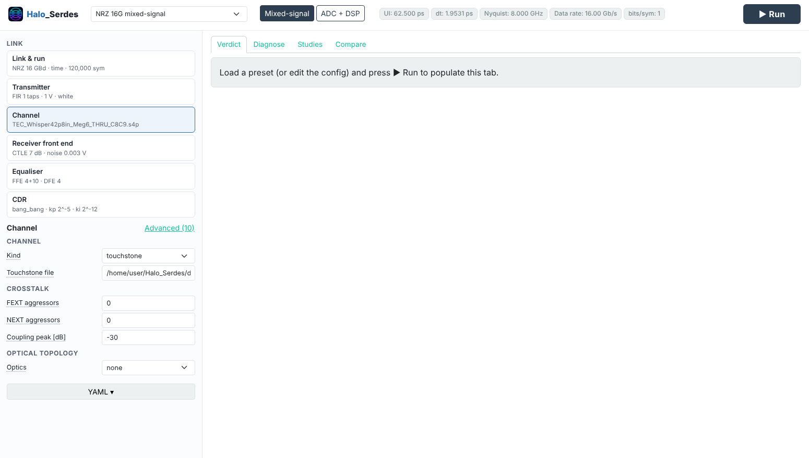

## 1. 结论 (Verdict)
对照 FEC 门限(NRZ 用 KR4,PAM 用 KP4,均按 post-FEC 1e-15 反推 pre-FEC 门限)给出通过 / 不通过 /
两引擎不一致 / 无法判定,逐个列出时域与 StatEye 各自的判断和裕量;旁边是 StatEye BER 与
时域 / StatEye 比值,下面是相位浴盆。结论要等 StatEye 算完,所以先显示时域结果卡(pre-FEC BER /
SER / slicer SNR / 混合信号接收机在 CTLE 输出处的 TJ@1e-12 / 引擎耗时),再补上结论。最下面是眼图
(ADC 接收机为由收敛抽头重建的 FFE 输出眼)、slicer 输入直方图和收敛后的 FFE/DFE 抽头。场景 A。

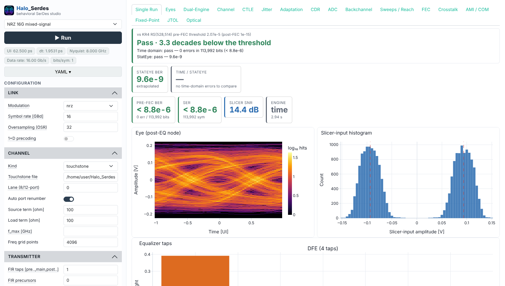

## 诊断 (Diagnose)
按链路分段的分析视图。在诊断工作区里点左侧某一段,就切到这一段的视图(信道 → Channel,
接收前端 → CTLE,均衡 → Equaliser,CDR → CDR ……)。

### 2. Eyes — 多观测点眼图
左:从 LTI 前端**重建**的模拟眼(`halo_serdes.analysis.reconstruct`,示例与 GUI 共用);
右:引擎捕获的均衡后 slicer 输入眼。ADC 架构下是 ADC 输入眼、重建的 FFE 输出眼和 slicer 样本云。

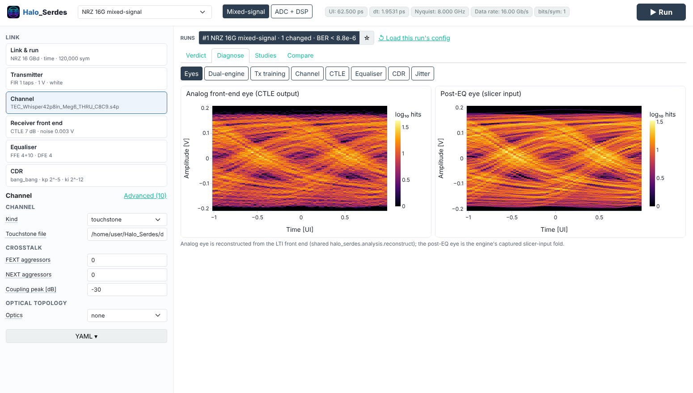

### 3. Dual-engine — 双引擎交叉校验
统计 StatEye 眼(log-PDF)、相位浴盆(叠加时域 MC 点)、slicer PDF 的统计-vs-MC 对照。

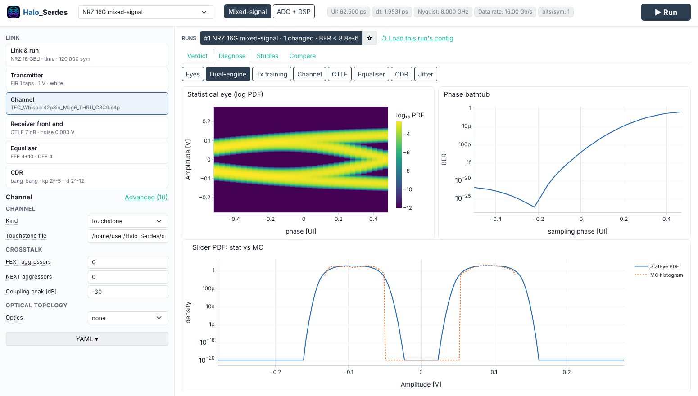

### 4. Channel — 信道特征
插入损耗(带 Nyquist 线)、冲激响应、脉冲响应 + UI 光标,以及行为级 COM 卡片与分解。
(2026-10-28 前这一页渲染失败:`com_fig or 占位图` 里没有子元素的 Graph 判为假,
页面拿到裸 figure,浏览器报 React #31,屏幕上停留在上一页。)

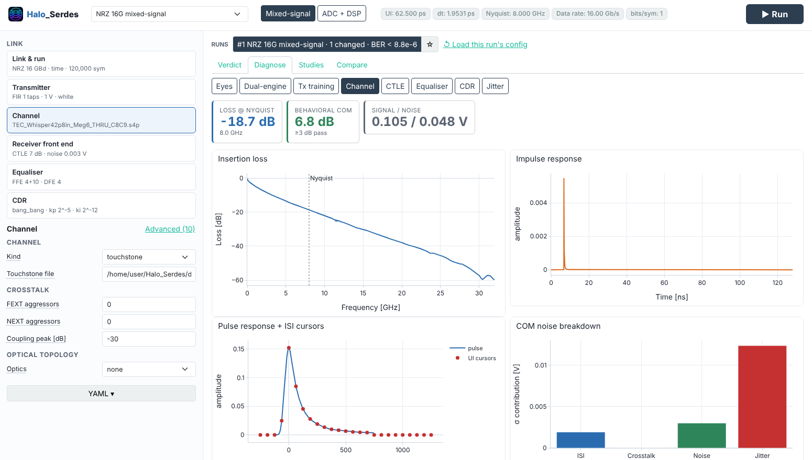

### 5. CTLE — 连续时间线性均衡器频响
CTLE 传函 |H(f)| 与实现峰化;零点/极点默认由峰化目标与 Nyquist 推导,可在配置里覆盖。

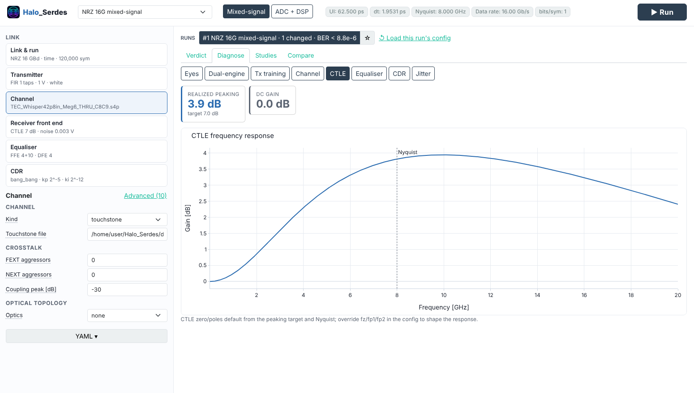

### 6. Jitter — 逐级抖动预算
PyBERT 式三层分解在 Tx / 信道 / CTLE 后三个观测点:预算表 + 堆叠条(ISI/DCD/Pj/Rj 尾 + TJ 标记)
+ 定时浴盆。需要重复码型(≥4 周期,如 prbs7)。

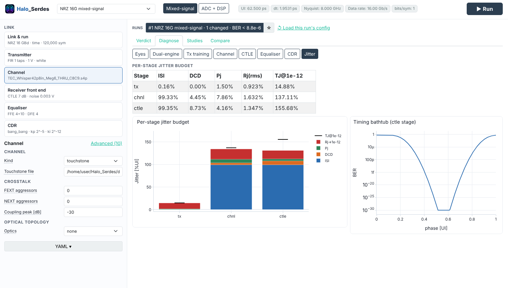

### 7. Equaliser — 自适应收敛
DFE 抽头轨迹(虚线=收敛值,阴影=CDR-settle / data-aided 训练窗)与抽头矢量收敛学习曲线。

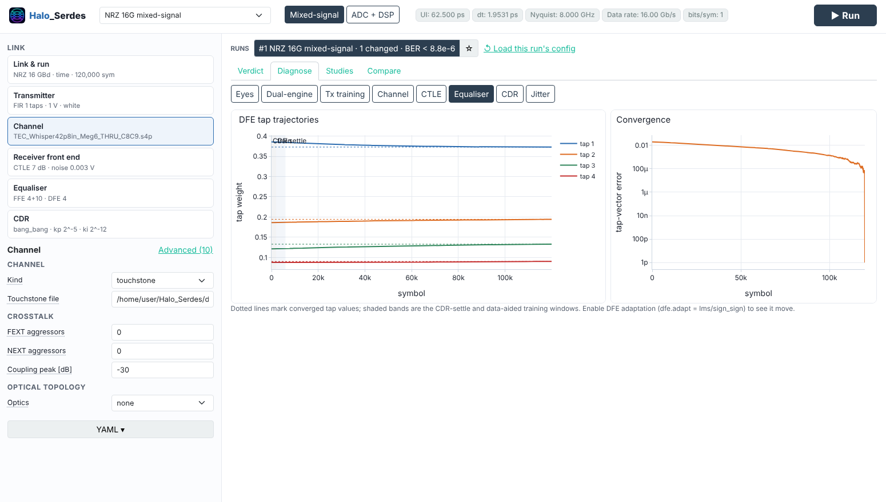

### 8. CDR — 时钟恢复动态
恢复相位的捕获轨迹(斜率=残余频偏,平坦=锁定)与相位检测器活动。

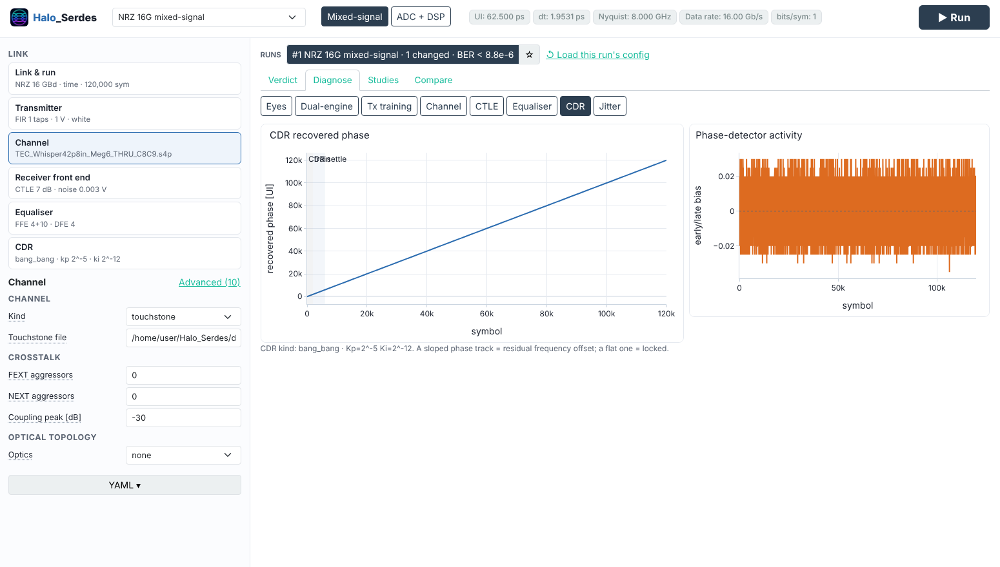

### 9. ADC — ADC-based 接收机诊断(场景 B)
逐 lane SER 条、ADC 码直方、时间交织失配(offset/skew)、收敛后 15-tap FFE + 1-tap DFE。
只在 `rx.arch = adc_dsp` 时出现。

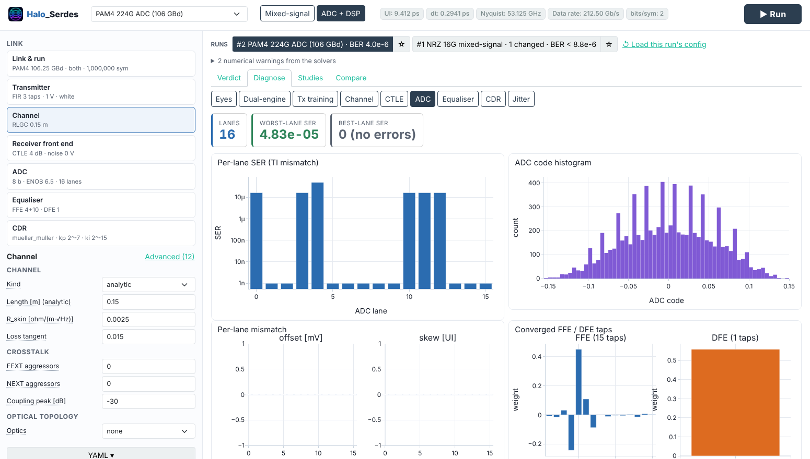

### 10. Tx training — Tx FIR 训练
KR 式符号 LMS 反向通道训练:cursor/main 比与 Tx 抽头随轮次的轨迹(RX DFE 覆盖的后光标不计入目标)。

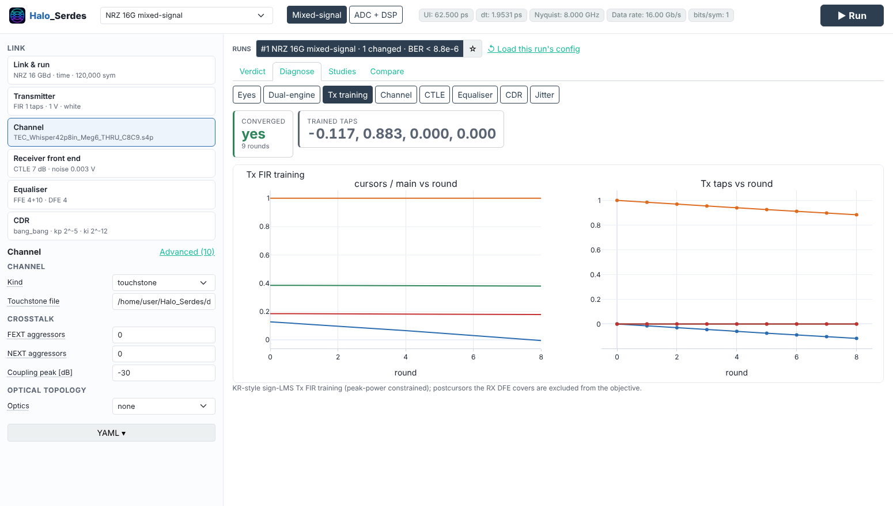

## 研究 (Studies)
扫描与投影,每个先给说明和 ▶ Run 按钮,点了才算(一秒到约 20 秒),结果按运行保留。

### 11. Sweeps / Reach — reach 扫描(场景 B)
统计引擎沿信道插损扫描 pre-FEC 与 post-KP4/KR4 BER,插值 1e-15 交点给出 reach。需要解析信道。

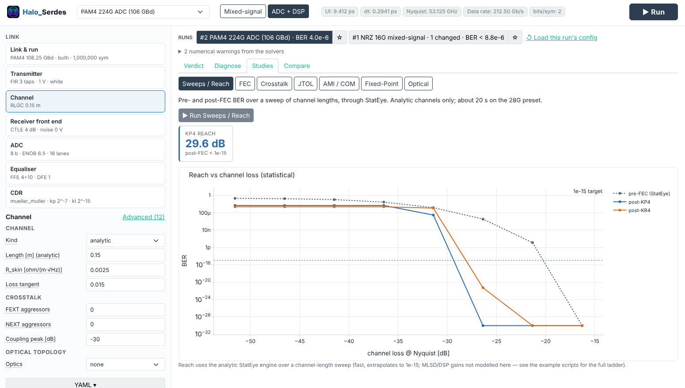

### 12. FEC — 前向纠错投影
KP4/KR4 与级联内码的 pre→post-FEC BER 投影,并标注本次运行的 pre-FEC 工作点。

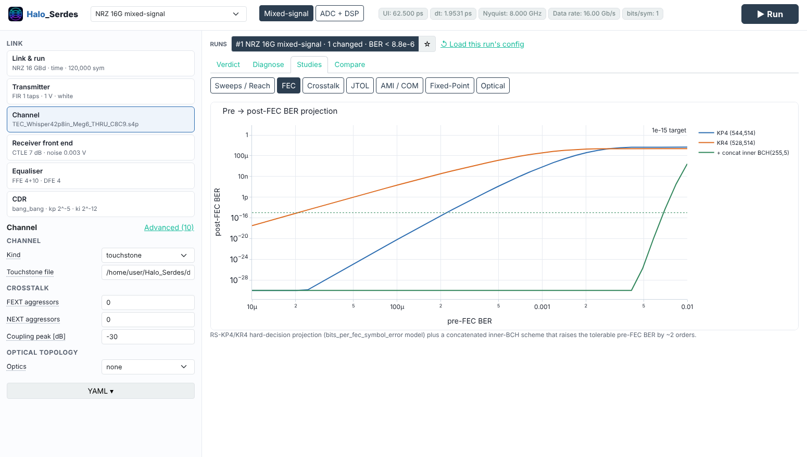

### 13. Crosstalk — 串扰
一对 FEXT+NEXT 合成侵略者在统计引擎中的耦合强度扫描 BER(同一 `XtalkAggressor` 也驱动时域引擎),
以及多 lane 环境下 ICN 与 802.3 COM 随侵略者数的变化。

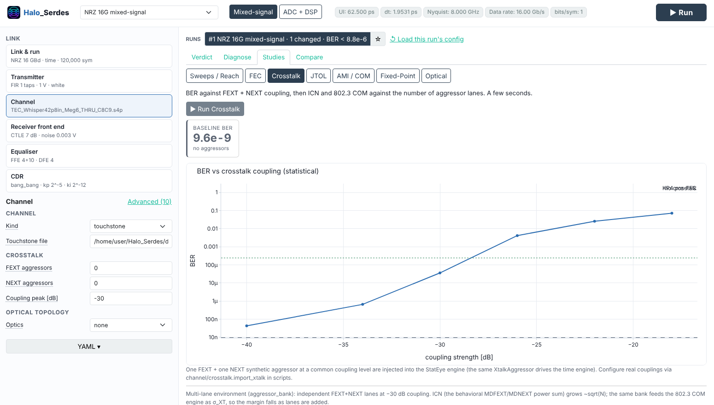

### 14. AMI / COM — 产业接口(场景 B)
IEEE 802.3 COM(93A/178A)vs 插损,叠加行为级 RSS FoM,经 `ComAdapter.compute` 接口;
顶部显示 IBIS-AMI 后端的可用状态。需要解析信道。

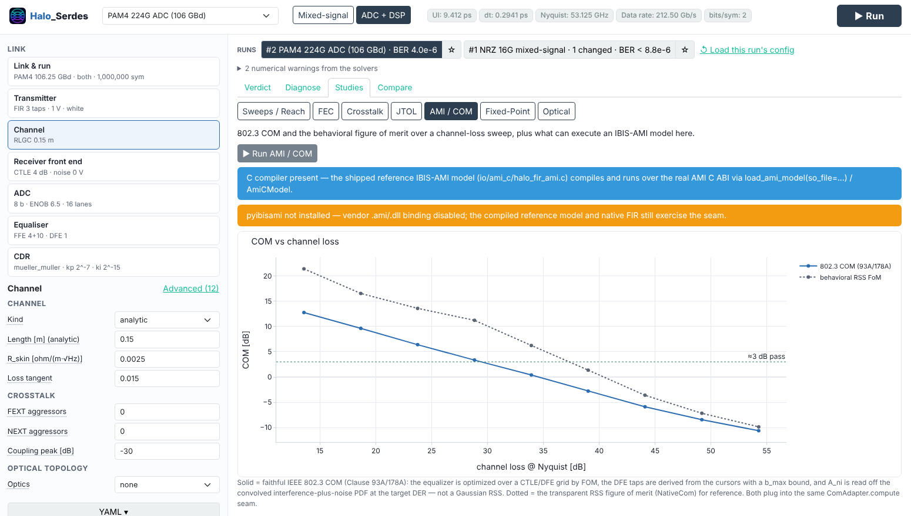

### 15. Fixed-Point — 定点字长(场景 B)
对捕获的 ADC 码做定点数据通路 bit-true 回放,扫描 FFE/DFE 权重字长得到 BER 墙(含 DragonPHY2 10b 硅参考线)。

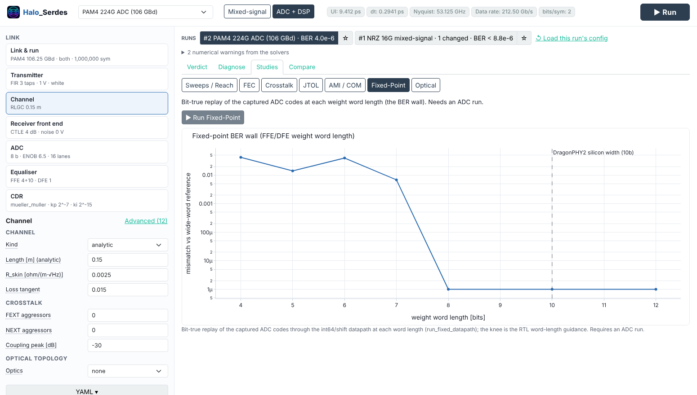

### 16. JTOL — 抖动容限
各频率下用二分搜索找出可容忍的正弦抖动幅度,叠加通用模板;CDR 跟得上处平坦,环路带宽以上约 20 dB/dec 下降。

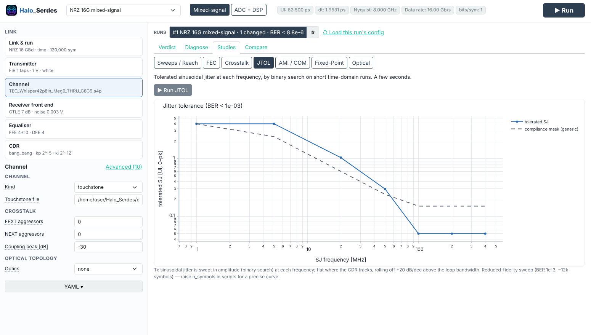

### 17. Optical — 光互联(场景 C)
级联插损在光电二极管处拆开、各电平的 PD 节点噪声、按光纤长度的 reach(原样 vs DSP 重定时)、发端 TDECQ。

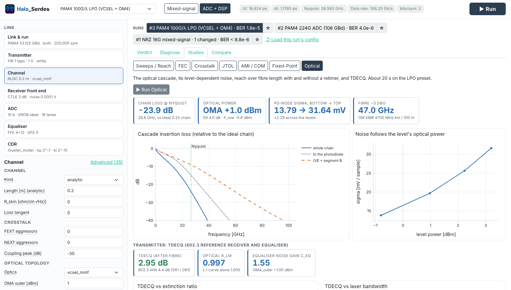

## 18. 对比 (Compare)
从运行条里勾选两次或更多运行:StatEye 相位浴盆画在同一坐标上、结果表(接收机、BER、误码数、SER、SNR、
StatEye、比值、结论、耗时)、两者不同的配置字段。"⇄ 用另一种架构运行"把当前运行的配置翻转 `rx.arch`
后再跑一次,跑完自动与原运行并排。图中是场景 B 与场景 A。

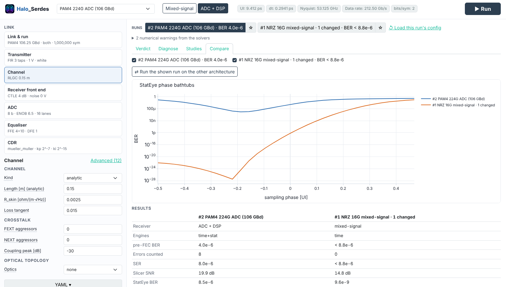

## 19. 窄屏
宽度不足 992 px 时结果在前、链路配置在后。

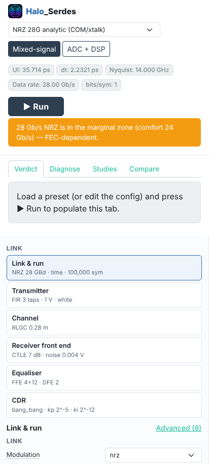

---

> 四个工作区共 18 个视图,覆盖示例脚本的全部分析能力;GUI 不新增任何仿真逻辑,只驱动现有引擎
> 并渲染 `SimResult` / `StatResult`。
